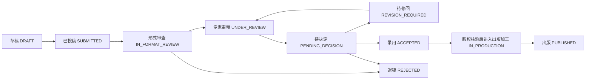
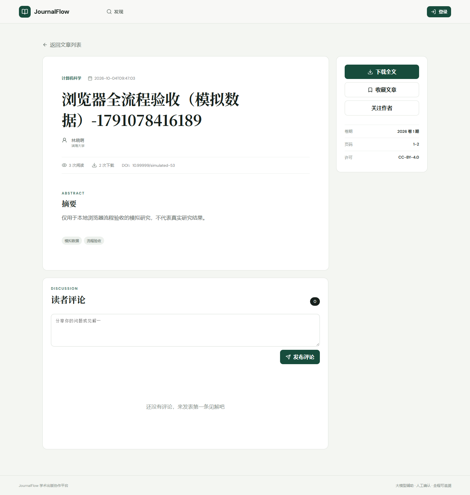
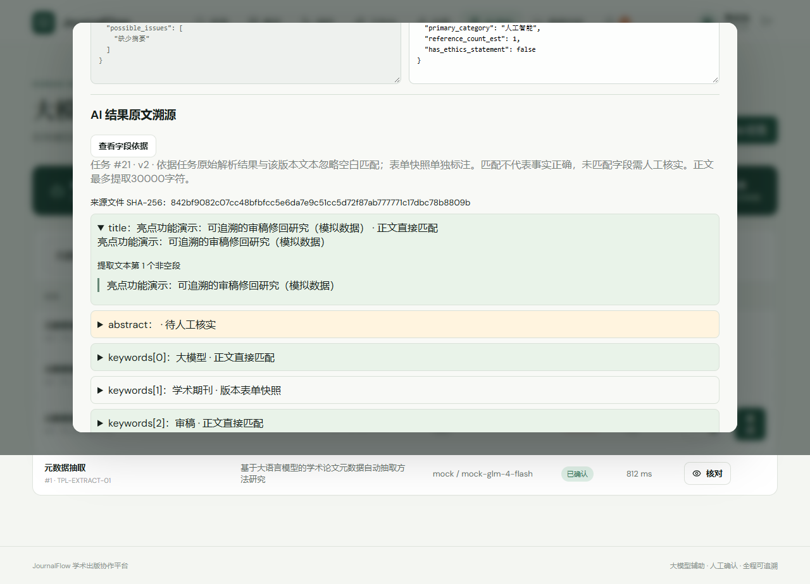

# JournalFlow 学术期刊投稿审稿与出版流程系统

对应课题：**基于大模型辅助的学术期刊投稿审稿与出版流程系统设计与实现**。

面向作者、审稿专家、编辑和管理员，覆盖投稿、形式审查、专家审稿、修改复审、录用、版权签署与出版归档，同时提供公开检索、阅读互动、举报申诉及统计分析。大模型用于元数据抽取、审稿意见汇总和意见解释，不替代编辑或专家作出学术决定。

AI 任务保存来源版本、模板、原始结果与人工修订记录。元数据写回需要编辑确认；作者意见解释属于辅助建议，不自动修改稿件或推进状态，不能笼统理解为“所有 AI 输出都先经人工确认才显示”。

> 本项目用于本地开发、教学演示和毕业设计验收。默认使用 Mock 模型；真实模型接口适配已实现，但外部服务联调与效果评测尚未完成。首页检索仅覆盖本站已出版文章，不是知网、万方等外部学术文献库。演示人物、论文和 DOI 均为模拟信息。

## 目录

- [技术栈](#技术栈)
- [项目架构与目录](#项目架构与目录)
- [本地启动](#本地启动)
- [演示账号](#演示账号)
- [构建与测试](#构建与测试)
- [辅助亮点功能](#辅助亮点功能)
- [功能角色与页面导航](#功能角色与页面导航)
- [完整投稿审稿出版演示](#完整投稿审稿出版演示)
- [上传文件与版本管理](#上传文件与版本管理)
- [大模型配置与验收](#大模型配置与验收)
- [数据库关系与接口约定](#数据库关系与接口约定)
- [常见问题与排查](#常见问题与排查)
- [已知限制与后续工作](#已知限制与后续工作)
- [配套文档与截图](#配套文档与截图)

## 技术栈

- 前端：Vue 3、Vue Router、Axios、Vite、ECharts、Lucide 图标
- 后端：Java 17、Spring Boot 3.3.5、Spring Security、MyBatis-Plus 3.5.5、JWT
- 数据库：MySQL 8
- 大模型：OpenAI 兼容接口或内置 Mock Provider
- 文本处理：PDFBox、DOCX 文档 XML 提取、UTF-8 TeX 文本读取
- 测试：JUnit/Spring 测试、真实 MySQL 流程回归、Vitest、Playwright/Edge

## 项目架构与目录

```text
浏览器 / Vue 前端
    └─ /api → Vite 开发代理 → Spring Boot :8080
                                  ├─ MySQL journalflow：业务、版本与审计数据
                                  ├─ backend/uploads：稿件附件
                                  └─ LLM Provider：Mock 或配置的模型服务
```

```text
.
├─ backend/
│  ├─ pom.xml
│  ├─ src/main/java/com/journalflow/
│  │  ├─ controller/       HTTP 接口与权限入口
│  │  ├─ service/          业务、AI 任务、文本处理与留痕
│  │  ├─ entity/           数据实体
│  │  ├─ mapper/           数据访问
│  │  ├─ dto/              请求字段及校验
│  │  ├─ llm/              模型 Provider
│  │  ├─ statemachine/     稿件状态流转
│  │  └─ common/           响应、异常、分页等公共能力
│  ├─ src/main/resources/application.yml
│  ├─ src/test/            后端自动化测试
│  ├─ uploads/             本地附件，不可随意清空
│  └─ target/              构建和测试产物
├─ frontend/
│  ├─ src/views/           业务页面
│  ├─ src/components/      公共及辅助工具组件
│  ├─ e2e/                 浏览器冒烟测试
│  ├─ e2e-full/            单独执行的完整出版流程测试
│  ├─ scripts/             亮点模拟数据准备脚本
│  ├─ playwright.config.js
│  ├─ playwright.full.config.js
│  └─ package.json
├─ sql/                    全量结构、种子数据、旧库迁移
├─ scripts/local.ps1       Windows 启动、停止和状态查询
├─ start-local.cmd
├─ stop-local.cmd
├─ docs/                   演示、验收记录和截图
└─ .runtime/               运行时生成的进程记录及日志
```

## 本地启动

以下命令以 Windows PowerShell 为例，除特别说明外先进入项目根目录。

从 GitHub 获取项目：

```powershell
git clone https://github.com/xuxiaxuan/JournalFlow.git
cd JournalFlow
# 仅首次克隆、尚无本地配置时复制，避免覆盖已有配置：
if (!(Test-Path backend/src/main/resources/application.yml)) {
  Copy-Item backend/src/main/resources/application.example.yml backend/src/main/resources/application.yml
}
```

修改复制出的 `application.yml`，将数据库密码占位符替换为本机值。真实本地配置被 Git 忽略，仓库只提供配置模板；未复制模板时 Spring Boot 不会自动加载 `application.example.yml`。仓库也不包含依赖、构建产物、运行日志及实际上传附件，需按后续步骤准备数据库、依赖和模拟稿件。

### 0. 环境与端口检查

| 工具 | 要求或本轮验证环境 |
|---|---|
| JDK | 编译目标 Java 17；本轮 Maven 使用 17.0.12，JAR 也在本机 JDK 21 运行过 |
| Maven | 本轮使用 3.9.9，需能下载或已缓存依赖 |
| Node.js | 本轮使用 22.13.0；当前 Playwright 测试依赖要求 Node ≥20 |
| MySQL | 8.x，账号能够访问目标库 |
| 浏览器 | 自动化验收默认本机 Microsoft Edge |
| 网络 | 首次下载依赖、调用外部模型需要网络；依赖齐全后可用 Mock 本地演示 |

```powershell
java -version
mvn.cmd --version
node --version
npm.cmd --version
mysql --version
```

`java` 和 Maven 可能使用不同 JDK，编译错误时应同时检查。Windows 使用 `npm.cmd` 可避免 `npm.ps1` 执行策略问题。MySQL 客户端未加入 PATH 不代表数据库服务不存在，也可使用数据库 GUI 工具。

| 服务 | 默认地址/端口 | 说明 |
|---|---|---|
| 前端开发服务 | `http://127.0.0.1:5173` | 一键脚本启动的业务站点 |
| 后端 | `http://localhost:8080` | `/api` 接口 |
| MySQL | `localhost:3306` | 默认连接实例 |
| 浏览器测试前端 | `http://localhost:5193` | 测试自动启动，执行前保持空闲 |

### 1. 初始化数据库

**先区分首次安装与旧库升级。** 后端启动不会自动建库、导入种子数据或执行增量迁移。

首次安装时连接目标 MySQL，例如：

```powershell
mysql -h 127.0.0.1 -P 3306 -u root -p
```

密码在提示时输入。下面 SQL 在 MySQL 客户端或数据库 GUI 查询窗口执行，不是 PowerShell 命令：

```sql
CREATE DATABASE IF NOT EXISTS journalflow
  CHARACTER SET utf8mb4 COLLATE utf8mb4_unicode_ci;
USE journalflow;
```

确认目标库为空且允许初始化后，依次执行：

```text
sql/schema.sql
sql/data.sql
```

可在数据库 GUI 中打开文件、选中 `journalflow` 后执行；MySQL 命令行可用 `SOURCE` 加 SQL 文件绝对路径，Windows 路径使用 `/`。不要把 `< 文件.sql` 重定向当作 PowerShell 通用导入命令。

> `schema.sql` 含 `DROP TABLE`，会删除并重建业务表；`data.sql` 不是可反复运行的幂等升级脚本。当前全量结构已包含全部增量变更，全新初始化后不需要再运行迁移文件。

检查是否连对实例、数据是否导入：

```sql
SELECT @@hostname AS host, @@port AS port, DATABASE() AS selected_database;
SHOW TABLES;
SELECT COUNT(*) AS table_count
FROM information_schema.tables
WHERE table_schema = 'journalflow' AND table_type = 'BASE TABLE';
SELECT username, status FROM journalflow.user ORDER BY id;
```

当前全量结构定义 26 张表。表数量只是辅助检查，不能代替字段、索引和外键核对。

按本机环境修改 `backend/src/main/resources/application.yml` 中的数据库连接信息。

如果数据库已按旧版脚本初始化且需要保留现有数据，请不要重新执行会删表的
`schema.sql`，改为备份数据库、检查已应用变更后，按顺序执行**尚未应用**的迁移：

```text
sql/migration_20261001.sql
sql/migration_20261002_relations.sql
sql/migration_20261003_metadata_trace.sql
sql/migration_20261004_raw_output.sql
sql/migration_20261005_research_tools.sql
```

| 迁移 | 主要内容 |
|---|---|
| 20261001 | 举报处置前状态、DOI 唯一索引 |
| 20261002_relations | 核心对象外键关系 |
| 20261003_metadata_trace | AI 重试来源、人工确认元数据修订记录 |
| 20261004_raw_output | 原始模型输出使用 LONGTEXT，保留非法 JSON 等原文 |
| 20261005_research_tools | 逐条回应历史表 |

这些脚本不是统一的自动迁移系统，不能默认都可重复执行。重复列/索引应检查是否已经应用；DOI 重复或孤立数据造成约束失败时先核对数据，不要删除外键绕过错误。

配置重点：`spring.datasource.url/username/password` 对应本机数据库；`journal.upload-dir` 默认为 `./uploads`，相对后端工作目录；初次演示保持 `journal.llm.provider: mock`。不要在文档或截图中公开真实密码/密钥。

### 2. 启动后端

```powershell
cd backend
mvn.cmd clean package -DskipTests
java -jar target/journalflow-backend-1.0.0.jar
```

后端默认地址为 `http://localhost:8080`。项目所在路径包含中文时，部分 Windows Maven/JDK 组合运行 `spring-boot:run` 可能错误编码 classpath，因此默认使用上面已经验证的可执行 JAR 启动方式。

保留此终端，前端用另一个终端启动。后端应从 `backend` 目录运行，以保证附件相对路径正确。`-DskipTests` 仅用于跳过打包时测试，不表示测试通过。

### 3. 启动前端

```powershell
cd frontend
npm.cmd ci
npm.cmd run dev
```

打开 `http://localhost:5173`。开发服务器会把 `/api` 请求代理到后端。

仓库包含 `package-lock.json`，`npm ci` 按锁文件重新安装依赖。主动修改依赖版本时使用 `npm.cmd install` 并同步维护锁文件，不要为了普通运行错误直接删除锁文件。

手动启动的前后端在各自终端按 `Ctrl+C` 关闭，一键停止脚本不会接管手动服务。

### 4. 一键启动、更新与关闭

数据库和前端依赖已准备好后，在项目根目录执行，或双击相应 `.cmd` 文件：

```powershell
.\start-local.cmd
# 查看脚本管理的进程：
powershell.exe -NoProfile -ExecutionPolicy Bypass -File scripts/local.ps1 -Action status
# 结束演示：
.\stop-local.cmd
# 后端源码变更后，停止服务再重新构建启动：
.\start-local.cmd -Build
```

访问 `http://127.0.0.1:5173`。脚本缺少 JAR 时自动构建，已有 JAR 时默认复用；重复启动复用已跟踪进程。`-Build` 要求先停止服务，重新打包后端但不跑测试。前端使用开发服务器，不要求先生成 `dist`。

脚本核对 PID、启动时间和命令行，只关闭它自己启动的进程。端口被其他程序占用时会报错，不自动强杀；不初始化数据库、不停止 MySQL、不清空附件。日志位于 `.runtime/*.out.log` 和 `*.err.log`，每次新启动会覆盖相应服务日志。服务运行时不要删除 `.runtime/processes.json`。

### 5. 运行自检

```powershell
Invoke-RestMethod 'http://localhost:8080/api/published?page=1&size=1'
```

正常 JSON 业务响应 `code` 应为 `0`；接着检查首页、登录和稿件列表。后端根路径 `/` 没有业务首页，8080 根路径返回 404 不等于后端失败。

`npm.cmd run build` 只生成静态资源，不启动后端。`npm.cmd run preview` 也不是已经配置完毕的整站部署；独立静态部署需另外配置 `/api` 转发与前端路由回退。本仓库不宣称已完成生产部署。

## 演示账号

所有演示账号密码均为 `123456`。

| 角色 | 用户名 |
|---|---|
| 管理员 | `admin` |
| 编辑 | `editor1`、`editor2` |
| 审稿专家 | `reviewer1` 至 `reviewer4` |
| 作者 | `author1` 至 `author3` |

`author1` 同时拥有作者和审稿专家角色，可用于演示多角色账号。

因此 `author1` 的工作台可能显示专家任务，作者投稿和修回仍从“稿件”入口操作。三角色同时演示应使用不同浏览器或独立浏览器配置，避免同站点 localStorage 登录态互相覆盖。

## 构建与测试

```powershell
cd backend
mvn.cmd test

cd ../frontend
npm.cmd test
npm.cmd run build
```

真实 MySQL 流程回归（先初始化演示数据或完成上述迁移，在 `backend` 目录执行）：

```powershell
mvn.cmd '-Djournal.mysql.tests=true' test
```

该测试覆盖投稿、退修复审、AI 汇总确认、录用、版权签署和出版归档；业务数据在事务结束时回滚，附件使用临时目录。MySQL 自增计数可能前进，不应要求测试后 ID 连续。测试显式执行 AI 工作线程逻辑，不覆盖事务提交后的异步派发。未加 `-Djournal.mysql.tests=true` 的普通测试会跳过这些显式启用用例。

浏览器冒烟测试（先启动本地 8080 后端，在 `frontend` 目录执行）：

```powershell
npm.cmd run demo:research
npm.cmd run test:e2e
```

测试自动在 5193 端口启动前端，默认使用本机 Microsoft Edge；可通过 `PW_CHANNEL` 环境变量选择已安装的其他 Playwright 浏览器渠道。使用演示账号检查公开检索、全文下载、编辑工作台、AI 中心和作者页面权限，会产生正常登录日志、阅读和下载计数；临时草稿及亮点回应记录的写入范围见下文。完整投稿写入流程由上述 MySQL 测试覆盖；另包含 multipart 上传及授权附件下载的字节一致性验证。

额外执行 `npm.cmd run test:full-flow` 可通过三个浏览器会话实际操作投稿、形式审查、初审、退修复审、录用、版权签署、出版和匿名检索下载，核对修回文件的字节一致性。此命令不属于默认冒烟测试，**每次执行会新增并保留一篇标有“模拟数据”的稿件**（失败时也保留已提交的流程记录）；不要在正式业务数据库上运行。截图与失败追踪在 `frontend/test-results-full`，与冒烟结果分开保存。

投稿页面支持最大 20MB 的 PDF、DOC、DOCX、TeX、ZIP 文件。上传失败后可在同一草稿上重试，草稿可编辑；DOC、ZIP 的 AI 正文解析不受支持，会降级使用表单元数据。首页检索范围仅为本站已出版稿件，不包含外部学术文献库。

草稿表单支持共同作者新增、移除和排序、通讯作者设置及标签多选；投稿人固定为第一作者，已关联注册账号的姓名随账号保留。至少需要一位通讯作者。上传异常后会自动核对当前版本及文件 SHA-256，在可以确认同一文件已保存时恢复成功状态；重试前再次核对稿件状态。

浏览器测试还会创建一篇临时草稿，验证作者与标签编辑、真实无效文件上传的弹窗提示，并在测试结束时删除该草稿。操作日志会保留；不会修改已有稿件。
亮点验收还会在专用模拟稿件上追加一条作者回应及编辑确认，验证完成后稿件状态不变；这些历史记录保留，方便现场演示。

后端默认使用 Mock LLM，未配置 API Key 时也可演示三个 AI 场景。元数据抽取会读取已上传 PDF、DOCX 或 TeX 的真实文本；不支持或提取失败时降级到表单元数据，不能据此声称已阅读完整正文。AI 任务在事务提交后由后台线程执行，前端刷新运行状态；失败任务可重试。服务重启会把遗留 `RUNNING` 任务标记为失败，等待授权用户手动重试，并非自动续跑。原任务、重试链路和人工确认记录会保留。真实服务配置见后文“大模型配置与验收”。

代表性样例的检查口径和结果见 [LLM代表性样例评测报告.md](LLM代表性样例评测报告.md)。

### 最近一次验收与测试副作用

2026-10-04 本地验收记录如下，属于具体版本/环境下的历史结果，不保证后续修改后自动成立：

| 检查 | 结果 |
|---|---|
| 后端，含 MySQL 和模型协议测试 | 151 项通过，0 失败/错误/跳过 |
| 前端单元测试 | 19 项通过 |
| 浏览器冒烟 | 7 项通过 |
| 独立三角色完整流程 | 1 项通过 |
| 后端打包、前端构建 | 通过；统计图表资源仍有大于 500 kB 的体积提示 |
| 启动、重复启动、状态、停止及端口释放 | 已验证 |
| 真实外部模型调用及效果 | 尚未验收 |

后端报告位于 `backend/target/surefire-reports`，浏览器失败 trace 和截图在对应的 `test-results`/`test-results-full`。下次执行对应测试可能覆盖运行产物。模型协议测试使用本地 HTTP 测试服务，不使用真实密钥、不调用真实模型。

浏览器测试不是只读检查，也没有数据库事务回滚：保留登录/阅读/下载计数、操作日志和亮点样例回应历史；完整流程每次新增并保留模拟稿件，失败时也保留已发生的流程记录。只在模拟库运行。成功验收样例 #53 属于本机历史数据，重新初始化的库不会天然具有该 ID，应以脚本实际输出为准。

## 辅助亮点功能

- AI 中心 → 元数据抽取任务 → 核对 → 查看字段依据：将任务原始解析结果与对应版本文本核对，展示正文引用、版本表单快照或“待人工核实”。分类、估计数量等推断字段保持待核实；文本匹配不能代替事实审查。
- 稿件详情 → 修回辅助工具 → 正文版本对比：选择两个版本查看增删内容，按非空文本行对比，提取范围最多 30000 字符、对比最多 400 行；超限明确提示。支持可提取文字的 PDF、DOCX、TeX，扫描件、DOC、ZIP 无法直接比较正文。
- 稿件详情 → 审稿意见逐条回应：按对作者公开的意见换行拆分，填写回复、修改位置和可选版本关联；编辑可逐条确认。修改与确认均追加历史记录，旧页面覆盖会返回冲突，作者再次修改后恢复为待确认。

三个入口均为辅助工具，不修改原稿、模型原始结果、稿件状态，也不增加原业务的提交或录用条件。权限沿用作者、编辑与受邀审稿人的关系；编辑专用 AI 结果不向作者开放，给编辑的私密意见不进入作者清单。新数据库已包含回应表；旧数据库需执行上述 20261005 增量脚本。

`npm.cmd run demo:research` 在本地后端已启动、演示账号存在且使用 Mock 模型时执行。它通过正常业务接口新增一篇“亮点功能演示”模拟稿件，包含两个可提取文本的 TeX 版本、审稿意见及抽取任务，供浏览器测试和现场演示使用；重复执行复用完整样例，不修改已有稿件。旧演示 PDF 是占位附件，不具备可解析正文，应使用此样例验证文本对比。

## 功能角色与页面导航

### 功能模块

| 模块 | 已有能力 | 入口 |
|---|---|---|
| 身份权限 | 登录、注册、个人资料、密码修改、角色与账号状态管理 | 登录、个人空间、管理页面 |
| 稿件提交 | 草稿、作者顺序、通讯作者、分类标签、附件投稿、修回、撤回 | 稿件管理 |
| 审稿决定 | 形式审查、邀请、接受/拒绝、评分、意见、人工编辑决定 | 角色工作台 |
| 版权出版 | 作者签署、当前版本版权核验、卷期页码 DOI、出版归档 | 稿件管理、编辑工作台 |
| 内容发现 | 关键词/分类/日期组合查询、分页排序、推荐、文章详情 | 首页与公开文章 |
| 阅读互动 | 收藏、订阅、关注、评论、站内通知 | 文章详情、个人空间 |
| 治理 | 举报、申诉与处理记录 | 治理页面 |
| 运营管理 | 投稿趋势、审稿周期、举报处置等统计、用户/分类管理、日志 | 分析、管理页面 |
| AI 与辅助 | 三类文本任务、人工修订、字段依据、版本比较、逐条回应 | AI 中心、稿件详情 |

### 角色边界

| 角色 | 职责 | 关键限制 |
|---|---|---|
| 访客 | 检索、阅读与下载已出版文章 | 不能读取未公开稿件或执行需要登录的互动 |
| 作者 `AUTHOR` | 操作本人投稿、修回、签署版权、获得意见解释 | 不能自行录用出版，不能读取仅给编辑的意见 |
| 专家 `REVIEWER` | 处理邀请、查看授权版本、提交报告 | 按任务关系授权，不能随意访问其他稿件 |
| 编辑 `EDITOR` | 审查、分配、决定、AI 核对、出版、治理与分析 | AI 建议不能自动代替人工决定 |
| 管理员 `ADMIN` | 账号角色、分类、日志及管理业务 | 仍执行后端的数据与状态校验 |

前端菜单及路由只是交互层提示，后端也检查角色、对象关系和状态。共同作者署名不等同于自动拥有投稿人的全部操作权限。

### 页面路由

| 地址 | 页面/用途 |
|---|---|
| `/` | 本站已出版文章检索与推荐 |
| `/articles/:id` | 公开文章详情、下载与互动 |
| `/login` | 登录/注册 |
| `/dashboard` | 登录后概览 |
| `/manuscripts` | 稿件列表、投稿、修回、版权签署 |
| `/manuscripts/:id` | 稿件详情、版本与过程、修回辅助 |
| `/workbench` | 按角色展示待办 |
| `/account` | 个人空间 |
| `/governance` | 按角色展示举报、申诉与处置 |
| `/ai-center` | 作者授权的意见解释；编辑管理抽取/汇总等任务 |
| `/analytics` | 编辑/管理员统计分析 |
| `/admin` | 管理员系统管理 |

## 完整投稿审稿出版演示

### 稿件主流程



在已投稿、形式审查、专家审稿、待决定、待修回等允许阶段可撤回到 `WITHDRAWN`，不能任意跳过状态。举报与申诉可能触发另有记录的特殊处置，不属于上述普通投稿流转。

### 三角色现场操作步骤

1. **作者 `author1`**：稿件 → 新建投稿，填写标题、摘要、关键词和分类，可添加共同作者与标签，设置通讯作者。选择真实非空附件并“保存并投稿”；不选附件则“保存草稿”。
2. **编辑 `editor1`**：工作台找到新稿，“开始审查”后“填写结论”，填写说明并通过，进入专家审稿。
3. **编辑**：“邀请专家”，选择 `reviewer1` 对应专家，提交邀请。
4. **专家 `reviewer1`**：接受邀请，填写创新性、学术质量、表达清晰度评分及建议等级。给作者的意见与仅给编辑的意见分开填写，提交报告。
5. **编辑**：稿件进入待决定后，“作出决定”选择退修并说明理由。已确认 AI 汇总可以关联，但不是作出决定的必填前置条件。
6. **作者**：稿件列表点击“修回”，上传修改后的文件，填写修改说明和回复。系统新增版本，并为符合条件的原专家创建复审邀请。
7. **专家**：接受新一轮邀请并提交复审报告；**编辑**结合复审意见选择录用。
8. **作者**：录用稿件点击“签署版权”，阅读协议、勾选确认并签署。版权记录绑定具体稿件版本。
9. **编辑**：“版权与出版”，填写卷号、期号、页码和格式合规的 DOI，进入出版加工；再“正式发布”。模拟 DOI 不是注册成功的真实标识。
10. **匿名读者**：首页按标题检索，查看文章并下载全文。完整流程自动化用例会核对下载文件与修回上传内容逐字节一致。

多个专家参与时，先核对当前版本各任务是否完成，再判断为何尚不能作出决定。修回后处理的是新版本任务，不要用旧版结果代替；不要直接修改数据库状态模拟完成流程。

## 上传文件与版本管理

| 文件类型 | 上传 | AI 正文提取/版本对比 |
|---|---|---|
| PDF | 支持真实有效文件 | 支持可提取文字的 PDF，不提供扫描件 OCR |
| DOCX | 支持 | 提取文档文本，不保证复杂排版、公式及图表完整还原 |
| TeX | 支持 | 按 UTF-8 文本读取，不执行编译，不保证去除所有 TeX 命令 |
| DOC | 支持 | 不支持直接正文提取，使用可用表单元数据 |
| ZIP | 支持 | 不作为正文自动展开解析，使用可用表单元数据 |

- 单文件最大 20MB；后端 multipart 总请求上限为 25MB。
- 服务端会检查内容，不只看扩展名；普通文本改名为 `.pdf` 会被拒绝。
- 上传请求超时为 120 秒；异常后尝试核对服务器版本、文件大小与 SHA-256，不能确认成功时提示刷新或重试。
- 修回新增版本而非覆盖原附件，私有版本下载仍需授权。公开下载只通过已出版文章入口提供。
- 至少一名通讯作者，投稿人固定为第一作者；共同作者支持排序，已关联注册账号的姓名保留。
- 数据库与 `backend/uploads` 必须一起备份或迁移。只保留 SQL 会丢失实际附件；不要随意清空上传目录。
- 旧种子 PDF 是占位附件，正文解析演示应使用真实模拟文件或亮点样例的 TeX 附件。

## 大模型配置与验收

### 三个场景与输出约定

| 场景 | 输入及授权 | 主要输出字段 |
|---|---|---|
| `EXTRACT` | 来源版本文本与表单信息；编辑/管理员 | `title`、`abstract`、`keywords`、`primary_category`、`language`、`word_count_est`、`reference_count_est`、`has_ethics_statement`、`possible_issues` |
| `SUMMARY` | 当前版本审稿报告；编辑/管理员 | `summary`、`major_issues`、`minor_issues`、`consensus`、`dissent`、`suggested_decision` |
| `EXPLAIN` | 授权范围内给作者的意见；作者本人/编辑 | `explanations[{issue,plain,suggestion}]`、`action_items` |

当前版本没有报告时，不能生成汇总或解释。作者发起解释还需满足编辑已公开审稿决定等条件，不包含仅给编辑的私密意见。

输入模板要求只基于来源内容、不补造信息，输出需通过结构校验。任务保存稿件/版本、模板标识、Provider/模型、输入、原始输出、解析结果、人工确认与失败信息；结构校验失败会有限重试，仍失败则记录原因。即使原始输出不是合法 JSON，也保留用于排查。

Mock 为预设逻辑，不是真实模型推理，不能证明摘要质量和事实一致性。元数据抽取人工确认后才写回并保留前后快照，旧版本任务不能覆盖当前稿件；编辑决定只能关联符合要求的当前版本已确认汇总。作者意见解释是辅助建议，不自动修改论文或改变流程。

### 配置真实兼容服务

Provider 向 `base-url + /chat/completions` 发送 `model`、`messages`、`temperature`、`max_tokens`、`response_format: {type: "json_object"}`，读取 `choices[0].message.content`。服务须支持这些约定，不能仅凭“兼容”名称判断联调成功。

配置文件中的地址/模型名只是现有配置值，不保证外部服务当前可用。使用你已有服务实际支持的模型与地址，并确认允许向该服务发送模拟/脱敏稿件。

在项目根目录的**同一 PowerShell 终端**配置环境变量，无需将密钥写入源码：

```powershell
.\stop-local.cmd
$env:JOURNAL_LLM_PROVIDER = 'openai-compat'
$env:JOURNAL_LLM_BASEURL = '你的服务基础地址，不含 /chat/completions'
$env:JOURNAL_LLM_MODEL = '该服务支持的模型名'
$keyInput = Read-Host 'API Key' -AsSecureString
$env:JOURNAL_LLM_APIKEY = [System.Net.NetworkCredential]::new('', $keyInput).Password
.\start-local.cmd
# 服务进程继承变量后，清除当前终端中的密钥变量：
Remove-Item Env:JOURNAL_LLM_APIKEY
```

地址和模型是占位说明，必须替换。Spring 环境变量映射中 `api-key` 对应 `APIKEY`，`base-url` 对应 `BASEURL`。不要把密钥贴到聊天、截图或仓库；已启动 JVM 不会读取终端后来修改的变量，切换配置需重启。

| `journal.llm` 字段 | 当前默认值 | 含义 |
|---|---|---|
| `provider` | `mock` | 真实兼容服务使用 `openai` 或 `openai-compat` |
| `timeout-seconds` | `30` | 单次模型 HTTP 请求超时 |
| `temperature` | `0.2` | 请求采样参数 |
| `max-tokens` | `1024` | 输出 token 上限，截断可能导致 JSON 不完整 |

切回 Mock：先停止服务，清除本次设置的 `JOURNAL_LLM_PROVIDER`、`JOURNAL_LLM_BASEURL`、`JOURNAL_LLM_MODEL`、`JOURNAL_LLM_APIKEY` 变量，再启动；不要删除其他无关环境变量。

### 真实模型验收清单

1. 只上传模拟/脱敏材料，确认外部处理权限。
2. 分别执行三个场景，核对任务实际记录的 Provider/模型不是 Mock。
3. 保存任务 ID、来源版本、模板、原始输出和人工修订。
4. 对照原文检查题名、摘要、关键词是否遗漏；是否补造作者、结论、文献或数字；是否遗漏反对意见或泄露私密意见。
5. 核验鉴权、限流、超时、非法 JSON 等错误提示与重试行为。
6. 补充代表性样例评测报告，真实结果不能沿用 Mock 的通过结论。

本组外部验收尚未完成；本地 `OpenAiCompatProviderTest` 只验证 HTTP 协议与异常处理，不证明外部模型可用或效果合格。

## 数据库关系与接口约定

### 数据表分组

| 分组 | 表 |
|---|---|
| 身份与角色 | `user`、`role`、`user_role` |
| 分类标签 | `category`、`tag`、`manuscript_tag` |
| 稿件版本 | `manuscript`、`manuscript_version`、`manuscript_author`、`revision` |
| 审稿决定 | `review_assignment`、`review_report`、`editorial_decision`、`review_response` |
| 阅读互动 | `comment`、`favorite`、`subscription`、`follow` |
| 治理版权 | `report`、`appeal`、`copyright_record` |
| 智能审计 | `llm_task`、`metadata_revision`、`operation_log` |
| 通知统计 | `notification`、`view_stat` |

稿件关联多个版本，审稿任务/报告和 AI 任务关联其具体版本。`revision` 保存修回前后版本关系；`metadata_revision` 保存人工确认 AI 元数据的修改；`review_response` 是逐条回应的追加式历史，三者不能互相替代。版权记录也绑定具体版本。

完整结构以 [sql/schema.sql](sql/schema.sql) 为准，核心 ER 子图见 [交付验收记录](docs/交付验收记录.md)。

### 通用响应、身份与错误

接口前缀为 `/api`，普通 JSON 返回：

```json
{
  "code": 0,
  "message": "success",
  "data": {}
}
```

`data` 随接口变化；分页返回 `list`、`total` 等字段，文件接口直接返回文件流。授权请求携带 `Authorization: Bearer <token>`。字段、范围与权限以 DTO、Controller 及服务层实际校验为准。

| HTTP / 业务码 | 含义 | 处理方向 |
|---|---|---|
| 400 / 40001 | 参数校验失败 | 必填项、取值范围、文件、分页参数 |
| 401 / 40101 | 未登录或过期 | 重新登录 |
| 403 / 40301 | 无权限 | 核对角色及对象关系 |
| 404 / 40401 | 资源不存在 | 核对 ID 及删除情况 |
| 409 / 40901 | 状态或并发冲突 | 刷新后按当前状态操作 |
| 502 / 50009 | 依赖服务失败 | 模型错误和服务日志 |
| 500 / 50000 | 系统内部错误 | 保留复现步骤、检查日志 |

### 主要接口索引

下面路径均省略 `/api`；完整字段见 `backend/src/main/java/com/journalflow/dto` 与 `controller`。

| 功能 | 方法与路径 |
|---|---|
| 登录/身份 | `POST /auth/login`、`GET /auth/me` |
| 草稿 | `POST /manuscripts`、`PUT /manuscripts/{id}` |
| 投稿/修回 | `POST /manuscripts/{id}/submit`、`POST /manuscripts/{id}/revisions`，multipart `file` |
| 版本/时间线 | `GET /manuscripts/{id}/versions`、`GET /manuscripts/{id}/timeline` |
| 形式审查 | `POST /editor/manuscripts/{id}/format-review/start`、`POST /editor/manuscripts/{id}/format-review` |
| 邀请专家 | `POST /editor/manuscripts/{id}/assign-reviewers` |
| 接受/审稿 | `POST /reviews/assignments/{id}/accept`、`POST /reviews/assignments/{id}/report` |
| 编辑决定 | `POST /editor/manuscripts/{id}/decision` |
| 版权 | `POST /manuscripts/{id}/copyright` |
| 出版/归档 | `POST /editor/manuscripts/{id}/publish`、`POST /editor/manuscripts/{id}/archive` |
| 公开检索/下载 | `GET /published`、`GET /published/{id}/file` |
| AI 创建/查询 | `POST /llm/tasks`、`GET /llm/tasks/{id}` |
| AI 确认/重试 | `POST /llm/tasks/{id}/confirm`、`POST /llm/tasks/{id}/retry` |
| 对比/依据 | `GET /manuscripts/{id}/compare`、`GET /llm/tasks/{id}/evidence` |
| 回应/确认 | `GET/POST /manuscripts/{id}/responses`、`POST /manuscripts/{id}/responses/{responseId}/confirm` |
| 举报/申诉 | `POST /reports`、`POST /appeals` |
| 统计/日志 | `GET /stats/overview` 等、`GET /admin/logs` |

公开检索支持组合 `keyword`、`categoryId`、`dateFrom`、`dateTo`、`sortBy`、`page`、`size`。AI 创建请求示例为 `{"scene":"EXTRACT","manuscriptId":123}`，其中 ID 需替换为授权且存在的稿件，创建后需继续查询异步状态。版本比较参数 `from`/`to` 使用版本记录 ID，不是显示的 v1/v2 编号。

## 常见问题与排查

### 1. 本机 MySQL 看不到对应库

核对数据库工具与 `application.yml` 的主机、端口，是否连到了另一实例；刷新库列表，执行 `SHOW DATABASES LIKE 'journalflow';`。后端不会自动建库，首次需手动导入。没看到库不等于可以直接重跑含删表操作的 `schema.sql`。

### 2. 学术论文检索没有结果

本站只检索已出版稿件，不检索外部文献库。草稿、审稿中、录用但未发布稿件不会公开出现。清空关键词、日期和分类条件，确认已有出版数据，再用一篇现有文章的标题词查询。

### 3. 上传失败或 PDF 不能解析

确认文件非空、≤20MB、内容与扩展名一致，查看弹窗错误。普通文本改名 PDF 不合规，旧种子 PDF 也不能用于正文解析验收。网络异常先刷新确认是否已生成版本，再在原稿件上重试，不必连续新建相同稿件。

### 4. 数据在，但附件下载失败

检查是否从 `backend` 目录启动，`journal.upload-dir` 是否指向真实附件目录，迁移时是否同步复制附件。只有 SQL 不能恢复文档；不要创建同名空文件来掩盖丢失。

### 5. 登录失败、权限不足或工作台角色不对

确认种子账号已导入、未禁用、密码正确；401 重新登录，403 核对角色及稿件关系。`author1` 同时是专家，作者操作从稿件页进入。修改浏览器保存的角色字段不能绕过后端权限。

### 6. 无法作出决定、复审或出版

核对当前版本的专家任务是否完成。修回后需处理新任务，不能以旧报告/旧 AI 汇总代替。录用后须由作者签署当前版本版权，编辑填写出版信息进入加工后再发布。不要直接改数据库状态绕过流程。

### 7. AI 失败、一直运行或没有正文依据

查看任务错误与来源版本，区分密钥、限流、超时和输出 JSON 格式问题。服务重启会标记遗留任务失败，需手动重试。新版本不会自动继承旧任务结果。扫描件、DOC、ZIP 或解析失败缺少正文依据是已知限制，不应伪造引用。

### 8. 修改代码/模型配置后不生效

脚本默认复用 JAR：停止后执行 `start-local.cmd -Build`。确认访问的是本项目端口，不是遗留实例。已运行 JVM 不会读取后来设置的模型环境变量，修改后需重新启动。

### 9. 端口被占用或脚本不能关闭服务

```powershell
Get-NetTCPConnection -State Listen -LocalPort 8080,5173,5193 -ErrorAction SilentlyContinue |
  Select-Object LocalAddress,LocalPort,OwningProcess
```

先确认对应进程。手动启动的回原终端关闭，一键脚本只管理自己跟踪的进程。不要按进程名批量结束所有 Java、Node 或浏览器，也不要删除运行中的跟踪文件。

### 10. 依赖、构建或浏览器测试无法启动

- Maven：检查 `mvn.cmd --version` 的 JDK、本地缓存权限与依赖下载；中文路径优先采用 JAR 启动。
- npm：使用 `npm.cmd`、检查 Node 版本、按锁文件安装依赖；网络失败不等于业务故障。
- Playwright：确认 Edge 已安装、5193 空闲、8080 可用，并先准备亮点样例。其他渠道必须是本机已安装且受支持的浏览器。
- 启动日志：`.runtime/backend.out.log`、`backend.err.log`、`frontend.out.log`、`frontend.err.log`；手动运行则看相应终端。受限环境禁止进程查询时，换到具备对应权限的本机终端检查。

## 已知限制与后续工作

1. **真实模型效果待验收**：Mock 与 HTTP 协议测试不能证明真实服务质量或事实一致性。
2. **无外部学术库检索**：提供本站内容发现与检索，不承诺第三方全文资源。
3. **文档解析有边界**：无 OCR，无 DOC/ZIP 正文提取；复杂公式、图表和排版不保证完整还原。
4. **版本比较不是查重**：文本行比较有范围上限，不提供语义查重或学术不端鉴定。
5. **规模性能尚可优化**：部分工作台先加载多页再筛选，未完成大规模并发/压力验收；图表资源体积可继续优化。
6. **生产与恢复需独立验证**：一键脚本面向本地演示，未宣称安全加固、生产部署、自动备份及灾难恢复全部完成。
7. **回应单导出暂未增加**：属于可选扩展，不在已完成功能中。

演示前检查 MySQL、附件、账号与核心测试结果。备份同时保留数据库和上传目录，在独立环境验证恢复，不在现有演示库上尝试破坏性恢复。按用户要求，本轮未修改现有本地安全配置。

## 配套文档与截图

| 文档 | 用途 |
|---|---|
| [本地演示与验收](docs/本地演示与验收.md) | 现场启动、演示顺序、测试与模型配置 |
| [交付验收记录](docs/交付验收记录.md) | 测试证据、课题映射、核心 ER 子图、接口与未验收项 |
| [LLM 代表性样例评测报告](LLM代表性样例评测报告.md) | 代表性输入及现有检查结果，真实模型效果需另行补录 |
| [系统设计方案](期刊投稿审稿系统-设计方案.md) | 设计阶段需求与架构；当前实现以源码和最新验收记录为准 |

本地模拟稿件出版详情：



AI 字段依据：



截图仅代表当时的模拟环境。AI 截图对应历史任务和来源版本，不代表所有新投稿字段状态，也不是外部模型效果证明。
