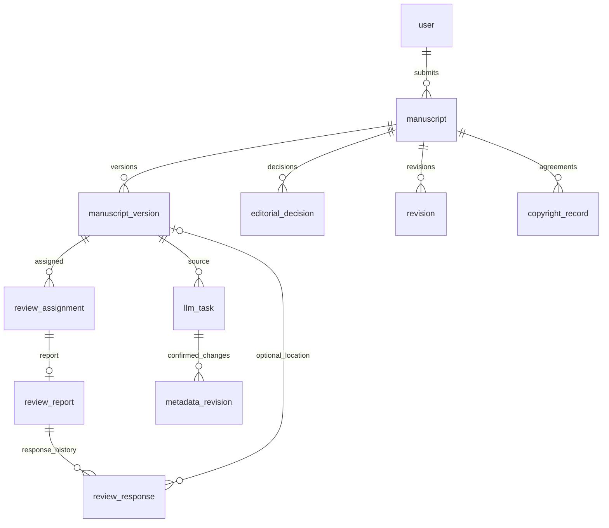

# 交付验收记录

验收日期：2026-10-04。范围：本机模拟数据库、Java/Spring Boot 后端、Vue 前端、Microsoft Edge；不包含外部模型效果、外部学术数据库或生产部署认证。原配置安全设置未修改，投稿审稿状态机未修改。

## 1. 本轮结果

| 检查 | 结果 | 证据与边界 |
|---|---|---|
| 后端回归 | 151 项通过，0 失败/错误/跳过 | `mvn -Djournal.mysql.tests=true test`，包含 5 项 MySQL 测试及新增 4 项模型协议测试 |
| 前端单元测试 | 19 项通过 | `npm.cmd test` |
| 浏览器冒烟 | 7 项通过 | `npm.cmd run test:e2e`，包括检索、下载、权限、无效上传、版本对比与回应确认 |
| 三角色完整浏览器流程 | 1 项通过 | `npm.cmd run test:full-flow`，真实 UI 操作与修回下载字节一致性验证 |
| 构建 | 后端打包与前端构建通过 | 前端统计图表资源仍有大于 500 kB 的体积提示，不影响本次构建 |
| 启动管理 | 构建启动、重复启动、状态查询、停止与端口释放验证通过 | Windows PowerShell 脚本，记录 PID、启动时间及进程命令行 |
| 真实模型 | 未验收 | 未配置 API Key，本地 HTTP 协议测试不等于外部调用 |

浏览器验收留下稿件 **#53**，标题 `浏览器全流程验收（模拟数据）-1791078416189`，状态 `PUBLISHED`，两个 TeX 版本；模拟 DOI 不是真实注册标识。调试失败的早期样例保留其已发生的流程记录，不修改原有业务稿件。

新增协议测试覆盖中文请求及 JSON 输出参数、成功解析、429 依赖失败、空结果、非法响应报文（四个用例）；不使用真实密钥、不访问外部模型。后端的既有测试另覆盖模板、输出校验、确认与修订留痕、权限及异常状态转换。

本轮实机截图已保存并人工查看：

- [模拟稿件出版详情](assets/published-acceptance.png)：匿名可见文章摘要、卷期与全文下载入口。
- [AI 字段依据](assets/research-evidence.png)：区分正文匹配、表单快照和待人工核实。该历史任务来自此前的版本快照，截图中空摘要不是本次新投稿的摘要；新投稿摘要读取已由全流程与冒烟测试验证。

## 2. 课题要求与实现落点

| 要求 | 实现入口 | 验证依据/限制 |
|---|---|---|
| 投稿→形式审查→专家审稿→修回复审→录用→出版 | 稿件管理、三角色工作台 | 本轮完整 UI 验收通过 |
| 检索、推荐、订阅、收藏、互动 | 首页、文章详情、个人空间 | 公开检索下载已浏览器验收；互动权限有后端回归；未逐一做全功能浏览器验收 |
| 举报、申诉、版权处置 | 治理页面、版权签署 | 版权进入完整流程验收；举报申诉有后端权限测试 |
| 结构化抽取、摘要汇总、问题解释 | AI 中心、作者解释入口 | Mock 与协议验证；真实模型效果仍待验证 |
| 输入模板、输出字段、人工核对、来源与修订 | `llm_task`、`metadata_revision`、字段依据 | 原始结果和人工结果分存；依据匹配不等于事实证明 |
| 身份认证、角色和对象权限、数据校验 | 控制器、服务层、文件授权下载 | 后端集成/单元测试及浏览器作者权限检查 |
| 组合查询、分页、统计图表 | 列表、工作台、分析页面 | 工作台仍有先加载多页后筛选的实现，数据规模扩大后可优化 |
| 操作日志、异常与版本追溯 | 管理日志、稿件时间线、版本与回应历史 | 状态校验、无效文件、旧版本结果、回应并发冲突等回归 |

这是一份按当前代码与测试证据整理的实现验收摘要，不将“已有入口”等同于“所有边界都测试完毕”。原《设计方案》保留为设计阶段材料，当前表及接口以源码和 SQL 为准。

## 3. 核心数据关系

当前 `sql/schema.sql` 共定义 26 张表。下图为投稿审稿与智能辅助的关系子集，省略用户角色、标签、互动治理、通知和统计等表，不表示完整 ER 图。

关键区别：`revision` 关联前后稿件版本及修回说明；`metadata_revision` 保存 AI 元数据人工确认的变更；`review_response` 是逐条回应的追加式历史，不替代稿件修回或审稿报告。版权签署绑定具体稿件版本。AI 原始任务输入输出与确认输出分离保存。

## 4. 主要接口索引

以下均以 `/api` 为前缀；除公开查询/下载外，按登录角色及稿件关系校验，不能仅依靠隐藏前端按钮授权。

| 业务 | 方法与路径 |
|---|---|
| 登录/身份 | `POST /auth/login`，`GET /auth/me` |
| 稿件建档/编辑 | `POST /manuscripts`，`PUT /manuscripts/{id}` |
| 文件投稿/修回 | `POST /manuscripts/{id}/submit`、`/{id}/revisions`，multipart `file` |
| 稿件版本/过程 | `GET /manuscripts/{id}/versions`、`/{id}/timeline` |
| 形式审查 | `POST /editor/manuscripts/{id}/format-review/start`、`/{id}/format-review` |
| 邀请/专家审稿 | `POST /editor/manuscripts/{id}/assign-reviewers`，`POST /reviews/assignments/{id}/accept`、`/{id}/report` |
| 编辑决定 | `POST /editor/manuscripts/{id}/decision` |
| 版权/出版 | `POST /manuscripts/{id}/copyright`，`POST /editor/manuscripts/{id}/publish`、`/{id}/archive` |
| 公开检索/下载 | `GET /published`，`GET /published/{id}/file` |
| AI 发起/确认/重试 | `POST /llm/tasks`，`POST /llm/tasks/{id}/confirm`、`/{id}/retry` |
| 字段依据/正文对比 | `GET /llm/tasks/{id}/evidence`，`GET /manuscripts/{id}/compare?from=版本ID&to=版本ID` |
| 逐条回应/确认 | `GET/POST /manuscripts/{id}/responses`，`POST /manuscripts/{id}/responses/{responseId}/confirm` |
| 举报/申诉 | `POST /reports`、`/appeals`，`POST /reports/{id}/handle`、`/appeals/{id}/handle` |
| 运营统计/日志 | `GET /stats/overview` 等，`GET /admin/logs` |

一般 JSON 接口返回 `code/message/data`；文件接口返回文件流。AI 任务异步执行，创建成功不代表模型处理完成，需查询任务状态。具体请求字段与校验见 `backend/src/main/java/com/journalflow/dto` 及各 Controller。

## 5. 尚未宣称完成的事项

- 真实模型服务联调与代表性样例事实一致性评测：需本机密钥或可达的本地模型服务。
- 扫描 PDF OCR、DOC/ZIP 正文解析、外部文献库检索：当前不支持，不以 Mock 伪装支持。
- 大规模并发、压力测试、备份恢复及生产部署安全验收：不在本轮本地演示验证范围。
- 回应单导出为可选扩展，本轮暂不增加，避免扩大收尾范围。

复现命令与真实模型配置说明见《本地演示与验收》。
