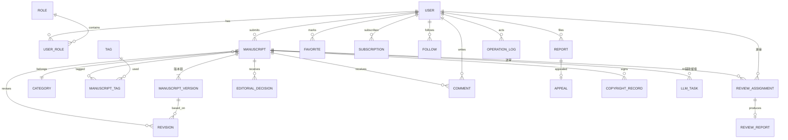

# 基于大模型辅助的学术期刊投稿审稿与出版流程系统 —— 设计与实现方案

> 课题类型：系统设计方向 | 课题来源：学校拟定 | 编制日期：2026-09-30
> 状态：已选题（未锁定），本文档可直接支撑开题报告撰写与后续开发

---

## 1 课题解读与需求映射

### 1.1 一句话概括

为学术期刊搭建一个覆盖 **投稿 → 形式审查 → 专家审稿 → 修改复审 → 录用 → 出版归档** 全流程的 Web 系统，并把大模型（只调用成熟 API，不自行训练）嵌入稿件信息抽取、审稿意见汇总与解释等文本处理环节；所有 AI 结果必须经人工确认后生效，全程留痕、版本可追溯。

### 1.2 课题原文要求 → 系统落点（逐条映射）

| 课题描述原文 | 系统落点 |
|---|---|
| 面向作者、编辑和审稿专家 | 4 类角色（作者/审稿专家/编辑/管理员），RBAC 权限控制 |
| 投稿、形式审查、专家审稿、修改复审、录用、出版归档 | 稿件状态机 + 各阶段工作台（见 §3） |
| 内容提交和审核发布 | 稿件管理模块 + 编辑工作台 |
| 检索推荐与订阅收藏 | 公开检索页（多条件组合+分页）、按学科/热度推荐、订阅与收藏 |
| 评论互动与关系维护 | 已出版文章的评论/回复、作者关注关系 |
| 举报申诉和版权处置 | 举报工单 + 处置流、作者申诉、版权协议签署留痕 |
| 内容质量与运营分析 | 管理端统计看板（ECharts，见 §8） |
| 大模型结构化抽取/摘要/问题解释 | LLM 服务模块三个场景（见 §6） |
| 输入模板、输出字段、人工确认、来源与修订记录 | Prompt 模板编号管理 + 输出 JSON Schema + `llm_task` 确认留痕表 |
| 代表性样例检查关键信息完整性和事实一致性 | 样例测试集 + 自动断言批跑（见 §6.5） |
| 认证、权限、数据校验、组合及分页查询、统计可视化、操作日志、异常处理 | 工程横切清单（见 §8） |
| 内容发布/审核/授权/互动/举报处置/版本记录可追溯 | `manuscript_version` 版本链 + 各环节关联 version_id + `llm_task`（见 §5） |
| 核心模块主要接口和典型异常流程测试 | 接口测试集 + 异常流测试（见 §8、§9） |
| 模拟或脱敏数据、最小必要授权、不收集无关个人信息 | 种子数据全虚构；不采集手机号等字段；权限按最小必要设计 |

> 答辩口径说明：课题描述中"学生或学习者、教师或业务指导人员、教学管理人员"是通用模板话术，在本课题语境下对应 **作者（学生/学习者）→ 审稿专家（教师/业务指导人员）→ 编辑与管理员（教学管理人员）**。

---

## 2 角色与权限设计

| 角色 | 职责 |
|---|---|
| 作者 Author | 撰写/提交稿件、修回并附修改说明、查看审稿意见与决定、申诉、评论互动 |
| 审稿专家 Reviewer | 接受/拒绝审稿邀请、审读指定版本、提交结构化审稿意见与评分 |
| 编辑 Editor | 形式审查（AI 预审+人工确认）、分配审稿人、汇总意见并作出决定（录用/退修/退稿）、出版归档、版权协议管理、举报处置 |
| 管理员 Admin | 用户管理、学科分类管理、运营统计看板、操作日志审计、举报终审 |

### 权限矩阵（最小必要原则）

| 动作 | 作者 | 审稿专家 | 编辑 | 管理员 |
|---|:---:|:---:|:---:|:---:|
| 创建/提交/修回稿件 | ✓（仅本人） | – | – | – |
| 形式审查、确认 AI 抽取结果 | – | – | ✓ | – |
| 分配/取消审稿任务 | – | – | ✓ | – |
| 提交审稿意见 | – | ✓（仅被分配稿件） | – | – |
| 复审决定（录用/退修/退稿） | – | – | ✓ | – |
| 出版、归档、版权协议 | – | – | ✓ | – |
| 评论、收藏、订阅、关注、举报 | ✓ | ✓ | ✓ | ✓ |
| 申诉 | ✓（仅本人稿件） | – | – | – |
| 举报处置 | – | – | ✓ | ✓（终审） |
| 用户管理、日志审计、统计看板 | – | – | – | ✓ |

除功能级权限外，所有"本人资源"接口（稿件、审稿任务、申诉）在服务端做 **数据级归属校验**，防止越权（IDOR）。

---

## 3 核心业务流程与稿件状态机

### 3.1 主流程

```
作者投稿(v1)
  → 编辑形式审查（LLM 结构化抽取辅助 + 编辑逐字段人工确认）
  → 通过 → 编辑邀请 2~3 名审稿专家
  → 专家接受邀请 → 审读稿件 → 提交审稿意见（评分 + 分级建议）
  → 编辑汇总（LLM 摘要辅助 + 人工确认）→ 编辑决定：
      ├─ 录用 → 签署版权协议（留痕）→ 编辑出版（卷期/页码/DOI 位）→ 归档发布
      ├─ 退修 → 作者修回(v2 + 修改说明) → 原专家复审 → 再决定（可循环）
      └─ 退稿 → 作者可申诉（1 次），管理员终审
任意阶段：作者可撤稿；举报可针对稿件/评论/用户发起 → 编辑处置 → 被处置方可申诉
已出版文章：进入公开检索页，可被阅读、评论、收藏、订阅推送
```

### 3.2 稿件状态机（manuscript.status）

```
DRAFT(草稿)
  → SUBMITTED(已提交，待形式审查)
  → IN_FORMAT_REVIEW(形式审查中)
  → UNDER_REVIEW(审稿中，含退修改回后的复审)
  → PENDING_DECISION(审稿完成，待编辑决定)
  → ACCEPTED(已录用) → IN_PRODUCTION(出版中) → PUBLISHED(已出版/归档)
  分支终态：REJECTED(退稿) / WITHDRAWN(撤稿)
退修支路：PENDING_DECISION → REVISION_REQUIRED(退修) → [作者修回] → UNDER_REVIEW
```

**规则**：状态流转只允许沿上图路径，非法流转后端返回 409 并写入操作日志——这正是"典型异常流程测试"的素材（见 §8）。

---

## 4 技术选型（推荐方案）

| 层 | 选型 | 理由 |
|---|---|---|
| 前端 | Vue 3 + Vue Router + 原生组件样式 + ECharts | 依赖精简，界面与统计看板可独立定制 |
| 后端 | Spring Boot 3.x（Java 17）+ MyBatis-Plus | 生态成熟，安全/校验/日志组件现成；若更熟悉 Python，可等价替换为 FastAPI + SQLAlchemy，模块结构同构 |
| 数据库 | MySQL 8.0 | 关系库硬性要求；检索用 ngram 全文索引或 LIKE + 索引即可满足毕设规模 |
| 认证 | JWT + Spring Security，密码 BCrypt | 无状态会话，配合注解式 RBAC |
| 大模型 | OpenAI 兼容 HTTP API 适配层（智谱 GLM / DeepSeek / 通义 / Ollama 本地任选），另内置 **Mock Provider** | 配置化切换厂商；答辩断网或无 Key 时切 Mock，演示不翻车 |
| 文件存储 | 本地磁盘（/uploads 按年月分目录），记录 SHA-256 校验和 | 最小必要，不上云 |
| 测试 | JUnit 5 + MockMvc（Python 方案则 pytest + httpx） | 接口级测试覆盖核心链路 |
| 部署（加分项） | Docker Compose：mysql + backend + web | 一键演示环境 |

---

## 5 数据库设计（核心 20 表，MySQL 8.0）

### 5.1 表清单与分组

**用户与权限**
| 表 | 关键字段 | 说明 |
|---|---|---|
| `user` | id, username, password_hash, real_name, email, affiliation(单位), research_fields, status, created_at | 按最小必要原则，不收集手机号、证件号 |
| `role` | id, code, name | 固定 4 角色 |
| `user_role` | user_id, role_id | 多对多，允许一人兼任作者+专家 |

**稿件主链**
| 表 | 关键字段 | 说明 |
|---|---|---|
| `manuscript` | id, submitter_id, title, abstract, keywords, category_id, status, current_version_id, created_at, updated_at | 稿件主表，冗余当前版本摘要字段便于列表查询 |
| `manuscript_version` | id, manuscript_id, version_no, title, abstract, keywords, file_path, file_hash, change_note, created_by, created_at | **版本链**：每次投稿/修回生成新版本，旧版本只读 |
| `manuscript_author` | manuscript_id, user_id, author_order, is_corresponding | 支持合作者；未注册合作者存姓名快照 |
| `category` | id, name, parent_id | 学科分类树 |
| `tag` / `manuscript_tag` | — | 标签多对多 |

**审稿流程**
| 表 | 关键字段 | 说明 |
|---|---|---|
| `review_assignment` | id, manuscript_id, **version_id**, reviewer_id, invited_by, invited_at, due_at, status(待接受/已接受/已完成/已拒绝/已超时) | 审稿邀请与任务 |
| `review_report` | id, assignment_id, score_novelty, score_quality, score_clarity, comments_to_editor, comments_to_author, recommendation(录用/小修/大修/退稿), submitted_at | 结构化审稿意见 |
| `editorial_decision` | id, manuscript_id, **version_id**, stage(形式审查/复审/终审), decision(通过/退修/退稿/录用), reason, decided_by, decided_at, summary_report(可关联 LLM 汇总任务) | 编辑决定记录 |
| `revision` | id, manuscript_id, based_version_id, new_version_id, response_to_reviewers, submitted_at | 修回：明确"基于哪一版改成哪一版" |

**互动与传播**
| 表 | 关键字段 | 说明 |
|---|---|---|
| `comment` | id, target_type(manuscript/comment), target_id, user_id, content, parent_id, status(正常/隐藏/删除), created_at | 支持两级回复，软删除 |
| `favorite` | user_id, manuscript_id, created_at | 收藏 |
| `subscription` | user_id, category_id, keyword | 订阅学科/关键词，新文章发布时推送站内消息 |
| `follow` | follower_id, followee_id | 关注作者（关系维护） |

**治理**
| 表 | 关键字段 | 说明 |
|---|---|---|
| `report` | id, reporter_id, target_type(manuscript/comment/user), target_id, reason_type(抄袭/造假/侵权/不当言论…), description, status(待处理/处理中/已处置/驳回), handled_by, handled_at, resolution, target_status_before（处置前状态快照） | 举报工单；申诉成立时按快照精确恢复 |
| `appeal` | id, report_id / decision_id, appellant_id, content, status, result, handled_by | 申诉（退稿申诉 + 举报处置申诉） |
| `metadata_revision` | manuscript_id, version_id, llm_task_id, changed_by, before_data, after_data, created_at | AI 元数据人工确认写回的前后快照 |
| `copyright_record` | id, manuscript_id, version_id, license_type(CC-BY 等), agreement_text, signed_by, signed_at | 版权协议签署留痕 |

**智能化与工程**
| 表 | 关键字段 | 说明 |
|---|---|---|
| `llm_task` | id, scene(extract/summary/explain), manuscript_id, version_id, template_id, input_digest, provider, model, raw_output, parsed_output(JSON), status(运行中/成功/失败/**已确认**), retry_of_task_id, confirmed_by, confirmed_at, confirmed_output, latency_ms, error_msg | **大模型来源与修订记录**，全系统 AI 可溯源的锚点；失败重试保留任务链路 |
| `operation_log` | id, user_id, action, object_type, object_id, detail(JSON), ip, created_at | AOP 切面统一写入 |
| `notification` | id, user_id, type, title, content, ref_id, read_at | 站内消息（审稿邀请、决定通知、订阅推送、举报进展） |
| `view_stat` | manuscript_id, view_count, download_count, stat_date | 阅读统计（推荐与运营分析的数据源） |

### 5.2 ER 关系图



### 5.3 可追溯性设计要点（课题重点）

1. **版本链**：`manuscript.current_version_id` 指向最新版本；`manuscript_version.version_no` 递增，历史版本不可修改。
2. **审的是哪一版**：`review_assignment`、`review_report`、`editorial_decision` 均携带 `version_id`，复审意见对应修回后的新版本。
3. **AI 可溯源**：任何展示 AI 生成内容的地方均可回跳到对应 `llm_task`，查看原始输出与人工确认后的差异。

建表示意（两张最关键的表）：

```sql
CREATE TABLE manuscript_version (
  id            BIGINT PRIMARY KEY AUTO_INCREMENT,
  manuscript_id BIGINT      NOT NULL,
  version_no    INT         NOT NULL,
  title         VARCHAR(200) NOT NULL,
  abstract      TEXT,
  keywords      VARCHAR(500),
  file_path     VARCHAR(500) NOT NULL,
  file_hash     CHAR(64)     NOT NULL COMMENT 'SHA-256',
  change_note   VARCHAR(500) COMMENT '相对上一版的修改说明',
  created_by    BIGINT      NOT NULL,
  created_at    DATETIME    NOT NULL DEFAULT CURRENT_TIMESTAMP,
  UNIQUE KEY uk_ms_ver (manuscript_id, version_no)
) COMMENT='稿件版本链，历史版本只读';

CREATE TABLE llm_task (
  id               BIGINT PRIMARY KEY AUTO_INCREMENT,
  scene            VARCHAR(20)  NOT NULL COMMENT 'extract/summary/explain',
  manuscript_id    BIGINT       NOT NULL,
  version_id       BIGINT       NOT NULL,
  template_id      VARCHAR(30)  NOT NULL COMMENT '输入模板编号',
  input_digest     VARCHAR(200)          COMMENT '输入内容摘要',
  provider         VARCHAR(30)  NOT NULL,
  model            VARCHAR(60)  NOT NULL,
  raw_output       JSON                  COMMENT '模型原始输出',
  parsed_output    JSON                  COMMENT 'Schema 校验后的结构化输出',
  confirmed_output JSON                  COMMENT '人工确认/修订后的最终输出',
  status           VARCHAR(15)  NOT NULL COMMENT 'RUNNING/SUCCESS/FAILED/CONFIRMED',
  confirmed_by     BIGINT, confirmed_at DATETIME,
  latency_ms       INT, error_msg VARCHAR(500),
  created_at       DATETIME NOT NULL DEFAULT CURRENT_TIMESTAMP
) COMMENT='大模型调用与人工确认留痕';
```

---

## 6 大模型智能化模块（核心亮点，重点实现）

### 6.1 设计原则

1. **只调用、不训练**：统一 `LlmProvider` 接口走 OpenAI 兼容 `/chat/completions`，厂商与模型在配置文件切换；另实现 `MockLlmProvider` 返回预置输出，保证断网可演示。
2. **强约束输出**：所有场景要求模型只输出 JSON，按预定义 JSON Schema 校验；解析失败重试 1 次，仍失败标记 `FAILED` 转人工。
3. **人在回路（Human-in-the-loop）**：AI 结果一律先进入"待确认"列表，由对应角色逐字段核对修订后点"确认"才生效；`raw_output` 永不覆盖。
4. **全程留痕**：每次调用写 `llm_task`，含输入模板编号、输入摘要、原始输出、确认输出、模型名与耗时。
5. **异步执行**：任务记录先以 `RUNNING` 状态提交，事务提交后由受控线程池调用模型；前端轮询运行状态，完成或失败后发送站内通知，避免模型响应时间阻塞创建任务接口。

### 6.2 场景 A：投稿信息结构化抽取（服务形式审查）

| 项 | 内容 |
|---|---|
| 模板编号 | `TPL-EXTRACT-01` |
| 输入 | system：“你是学术期刊编辑部助手，从稿件片段抽取元数据，只输出 JSON，不得编造未出现的信息。”；user：作者填写标题、摘要、关键词 + 从上传 PDF/DOCX/TeX 提取的真实文本节选（最多 12000 字符）；无法解析时明确标记并降级，不构造虚假正文 |
| 输出字段 | `{title, abstract(≤400字), keywords[3..8], primary_category(分类枚举), language(zh\|en), word_count_est, reference_count_est, has_ethics_statement, possible_issues[]}` |
| 人工确认 | 编辑在形式审查页对照稿件逐字段核对、可修改，点"确认入库"后更新稿件元数据，`llm_task.status=CONFIRMED` |
| 一致性断言 | keywords ⊆ 标题∪摘要∪正文高频词；primary_category ∈ 枚举；word_count_est 与文件解析实测偏差 ≤ 20% |

### 6.3 场景 B：审稿意见汇总摘要（服务编辑复审）

| 项 | 内容 |
|---|---|
| 模板编号 | `TPL-SUMMARY-01` |
| 输入 | 逐条拼装 N 份审稿意见（评分、建议等级、给编辑意见、给作者意见）；system："只归纳，不添加原文没有的信息" |
| 输出字段 | `{summary, major_issues[], minor_issues[], consensus(accept\|minor\|major\|reject), dissent, suggested_decision}` |
| 人工确认 | 编辑确认后生成《审稿综合意见》附入决定记录；**录用/退修/退稿决定本身仍由编辑人工作出** |

### 6.4 场景 C：审稿意见解释与修改指引（服务作者）

| 项 | 内容 |
|---|---|
| 模板编号 | `TPL-EXPLAIN-01` |
| 输入 | 退修稿收到的专家意见原文（逐条）+ 稿件当前版本号 |
| 输出字段 | `{explanations:[{issue原文引用, plain通俗解释, suggestion修改建议}], action_items[]}` |
| 人工确认 | 界面"意见原文 / AI 解释"并排展示，标注"由大模型生成，仅供参考"；点击可溯源至 `llm_task` 查看原始输出 |

### 6.5 代表性样例与一致性验收（对应课题硬要求）

- 构造 **12~15 个样例**：正常中文稿、英文稿、缺摘要稿、关键词超 8 个、超长截断稿、含/不含伦理声明、术语密集稿等。
- 每个样例定义期望字段与断言规则，脚本化批跑输出检查报告（通过率、失败原因分布）。
- 断言维度：**字段齐全性**、**枚举合法性**、**事实一致性**（抽取值 vs 稿件真实值）、**JSON 可解析率**。
- 量化指标写进论文测试章，例如：关键字段完整率 ≥ 95%、事实一致性断言通过率 ≥ 90%、断网 Mock 模式功能可用。
- 当前 14 个基线样例及自动化结果见项目根目录 `LLM代表性样例评测报告.md`。

### 6.6 降级与异常处理

- 超时（30s）或限流 → 提示稍后重试，**流程不阻塞**（人工填写路径始终可用）。
- 输出非法 JSON → 自动重试 1 次 → 标 `FAILED` 并通知任务发起人；用户可再次创建关联原任务的重试任务，历史失败记录不覆盖。
- 无 API Key / 断网 → 一键切换 Mock Provider。

---

## 7 接口设计概要

统一响应体：`{code, message, data}`；分页参数：`page, size, (keyword/status/categoryId/dateFrom/dateTo)` 组合查询，返回 `{list, total, page, size}`。
错误码分段：`0` 成功；`40101` 未认证；`40301` 越权；`40401` 不存在；`40901` 状态冲突（非法流转）；`40001` 参数校验失败；`50009` 依赖服务失败（如 LLM）。

| 模块 | 主要接口（方法 路径 → 权限） |
|---|---|
| 认证 | POST /auth/login；POST /auth/logout；GET /auth/me |
| 稿件（作者） | POST /manuscripts（创建草稿）；PUT /manuscripts/{id}；POST /manuscripts/{id}/submit；POST /manuscripts/{id}/revisions（修回+修改说明）；GET /manuscripts/my |
| 稿件（通用） | GET /manuscripts（组合查询+分页）；GET /manuscripts/{id}；GET /manuscripts/{id}/versions；GET /manuscripts/{id}/timeline（全流程留痕时间线） |
| 编辑工作台 | GET /editor/format-review-queue；POST /editor/manuscripts/{id}/format-review；POST /editor/manuscripts/{id}/assign-reviewers；POST /editor/manuscripts/{id}/decision（录用/退修/退稿）；POST /editor/manuscripts/{id}/publish |
| 审稿专家 | GET /reviews/my-assignments；POST /reviews/{assignmentId}/accept、/decline；POST /reviews/{assignmentId}/report |
| LLM | POST /llm/tasks（scene+manuscriptId 异步发起）；GET /llm/tasks?status=；POST /llm/tasks/{id}/retry（失败重试）；POST /llm/tasks/{id}/confirm（人工确认） |
| 公开阅读 | GET /published（检索+分页）；GET /published/{id}；GET /published/recommend |
| 互动 | POST/GET /comments；POST /favorites；POST/DELETE /subscriptions；POST /follows/{userId} |
| 举报申诉 | POST /reports；GET /reports（编辑）；POST /reports/{id}/handle；POST /appeals；POST /appeals/{id}/handle |
| 版权 | GET/POST /copyright/{manuscriptId}（签署留痕） |
| 统计 | GET /stats/overview、/stats/submission-trend、/stats/review-cycle、/stats/report-handling |
| 管理 | GET/PUT /admin/users；GET /admin/logs（分页）；CRUD /admin/categories |

---

## 8 工程要求落实清单（对照课题硬指标）

| 课题要求 | 实现方式 |
|---|---|
| 身份认证 | JWT（登录颁发 + 过期处理），BCrypt 密码散列 |
| 角色权限 | role/user_role 表 + 方法级注解鉴权 + 数据级归属校验（防越权） |
| 数据校验 | Bean Validation 注解（长度/必填/格式）+ 状态机校验 + 唯一性校验 |
| 组合及分页查询 | 多条件动态拼接 + 统一分页返回结构 |
| 统计可视化 | ECharts：投稿量趋势、各状态稿件分布、平均审稿周期、录用率、举报处置时效、活跃作者榜 |
| 操作日志 | AOP 切面拦截写 `operation_log`（动作/对象/差异/IP） |
| 异常处理 | 全局异常处理器 + 业务异常码 + 兜底 500，前端统一提示 |
| 版本可追溯 | manuscript_version 版本链 + 各环节关联 version_id + llm_task AI 留痕 + timeline 接口 |
| 测试 | ① 状态机流转单测 ② 权限/越权单测 ③ 核心链路接口测试（投稿→审→录→发全流程）④ 异常流测试（未登录 401、越权 403、非法流转 409、重复提交幂等、LLM 超时降级）⑤ LLM 样例集批跑 |
| 最小必要与脱敏 | 不收集手机号/证件号；演示数据全为虚构人物与虚构论文；密码散列存储 |

---

## 9 开发计划（建议 14 周）

| 周次 | 任务 |
|---|---|
| W1–W2 | 需求确认、页面原型、数据库设计定稿，完成开题报告 |
| W3–W4 | 框架搭建：登录/JWT、RBAC、全局异常、操作日志切面、分页骨架 + 种子数据脚本 |
| W5–W7 | 稿件主链路：投稿 → 形式审查 → 送审 → 审稿 → 退修 → 复审 → 录用 → 出版归档 |
| W8–W9 | LLM 三场景 + llm_task 留痕 + 样例集批跑与调优 |
| W10 | 检索/收藏/订阅/评论/关注 + 举报/申诉/版权处置 |
| W11 | 统计看板 + 测试补全（含典型异常流程） |
| W12–W13 | 论文撰写、演示数据脱敏、Docker 部署演练 |
| W14 | 答辩准备与演示彩排 |

---

## 10 风险与应对

| 风险 | 应对 |
|---|---|
| LLM 输出不稳定/格式错误 | JSON Schema 校验 + 重试 1 次 + Mock 兜底 + 人工兜底路径 |
| 演示断网或无 API Key | MockLlmProvider 预置输出，一键切换 |
| 范围蔓延进度失控 | 先保主链路闭环（W7 节点），互动/统计后置可裁剪 |
| 数据隐私合规 | 全虚构数据演示，不采集业务无关信息，最小必要授权 |

---

## 11 开题报告可复用素材

**研究背景与意义（三句话版）**：学术期刊投稿审稿流程环节多、周期长，编辑的形式审查与意见汇总大量依赖重复性人工劳动；大模型在文本结构化抽取与归纳摘要上已具备可用能力；将大模型以"人在回路"方式嵌入期刊工作流，可缩短处理周期、提升一致性，同时通过留痕机制保证可信与可追溯。

**研究内容（四条）**：① 期刊投稿审稿出版全流程的状态机建模与系统实现；② 大模型辅助的稿件信息抽取、意见汇总与解释模块设计（含输入模板、输出 Schema、人工确认与留痕）；③ 支撑内容发布、审核、互动、举报处置与版本追溯的数据模型设计；④ 系统测试（核心链路 + 典型异常流程 + LLM 一致性样例验证）。

**特色/创新点（两条）**：① 大模型结果"强 Schema 约束 + 人工确认 + 全程留痕"的人在回路工程范式，而非直接采信模型输出；② 以版本链贯穿投稿—审稿—修回—出版全链路，任何决定与 AI 辅助均可溯源到具体稿件版本。

**预期成果**：可运行的 B/S 系统（含演示数据）、接口与异常流测试报告、LLM 一致性检查报告、毕业论文。
